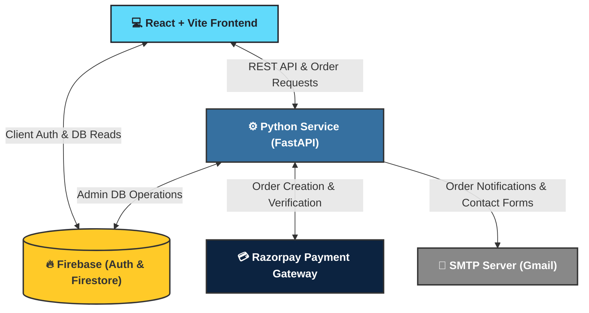

# Anthem Enzyme Website 🧬


A comprehensive e-commerce and internal management portal built for **Anthem Biosciences**. This platform facilitates the sale, tracking, and management of sensitive biological products (enzymes) while providing a robust Role-Based Access Control (RBAC) system for Admins, Employees, and Customers.

## 🏗️ System Architecture



## ✨ Key Features

- **🛍️ E-Commerce Storefront:** Browse, search, and purchase Anthem's enzyme products.
- **💳 Razorpay Integration:** Seamless, secure online payment and order verification.
- **🔐 Role-Based Access Control:** Distinct dashboards and permissions for Customers, Employees, and Admins.
- **📊 Data Management:** Export user and order directories to Excel. Browse massive data sets seamlessly with customizable pagination (10/25/50/100 entries per page).
- **✉️ Automated Notifications:** In-app alerts and automatic SMTP email generation sending real-time invoice receipts to admins upon successful order placements.
- **📦 Shipment Tracking:** Real-time visual tracking of orders from placement to delivery.
- **🌓 Dark Mode:** Sleek, dynamic UI with full light/dark mode support.

## 📂 Folder Structure

```text
anthem-enzyme-website/
├── frontend/             # React + Vite Frontend Application
│   ├── public/           # Static assets (images, icons, .htaccess)
│   └── src/              # React components, pages, and context providers
│       ├── components/   # Reusable UI components (NavBar, AuthModal, Footer)
│       ├── context/      # React Context (Theme, Auth, Cart)
│       └── pages/        # Route pages (Home, Dashboard, EditShipments, etc.)
├── python-service/       # Python Backend (FastAPI, Razorpay, Chatbot, SMTP)
├── firestore.rules       # Firebase security rules and RBAC policies
└── README.md             # Project documentation
```

## 🚀 Quick Start

### 1. Frontend Setup
```bash
cd frontend
npm install
npm run dev
```

### 2. Python Backend Setup
```bash
cd python-service
pip install -r requirements.txt
python main.py
```

## 🛡️ Security & Secrets
Environment variables (`.env`) and Firebase Admin SDK keys (`*firebase-adminsdk*.json`) are strictly ignored via `.gitignore` to prevent secret leaks. Ensure you have the proper `.env` files created locally before running the services.
